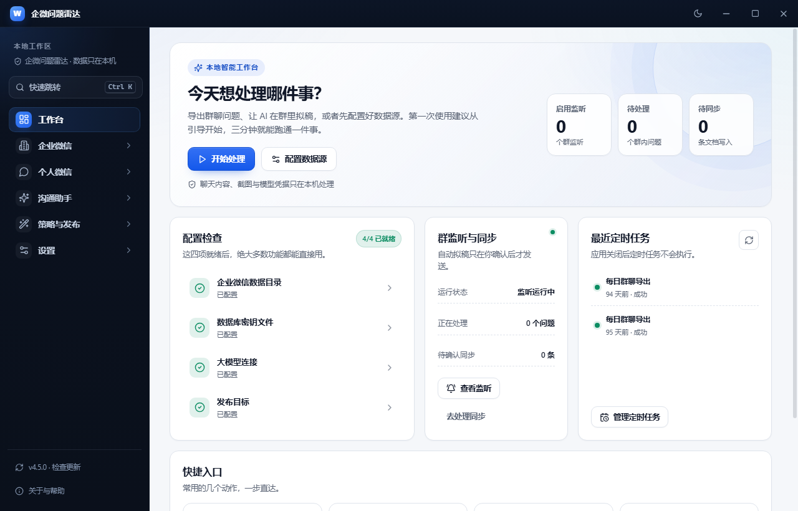
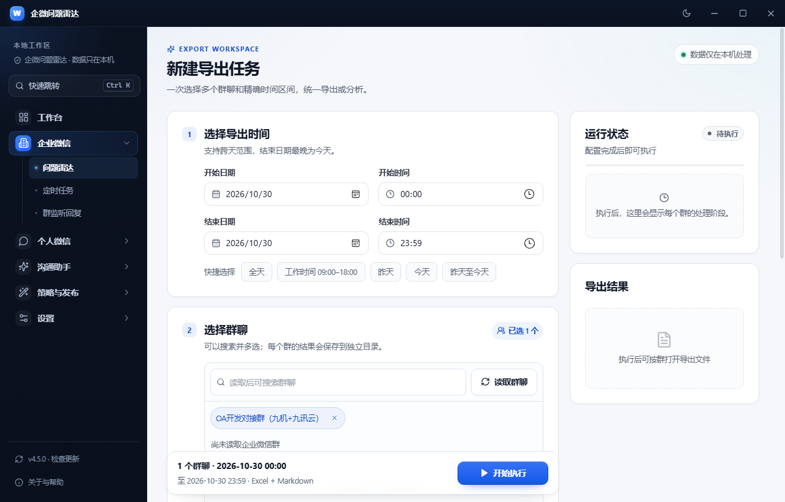
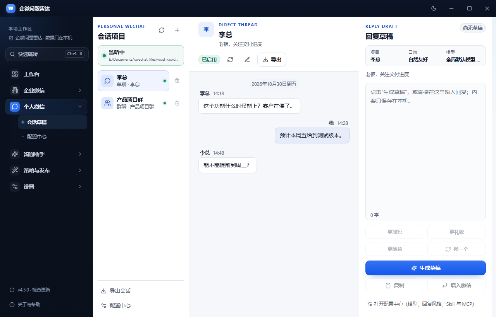
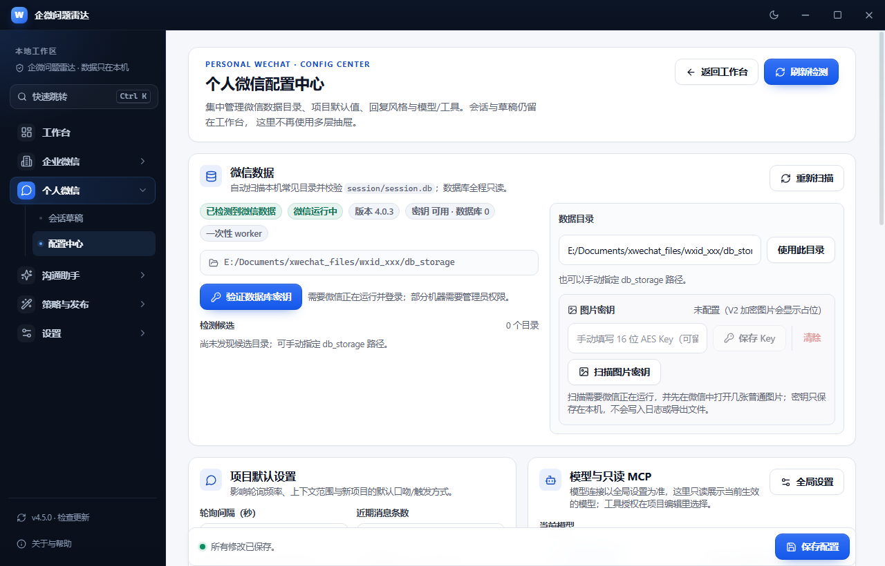
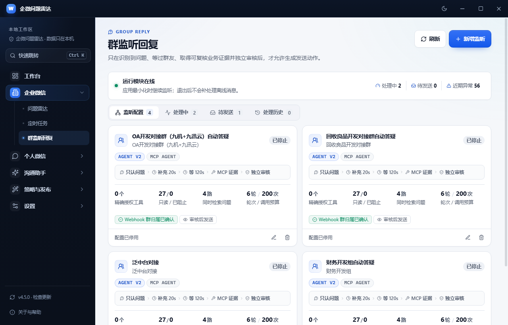
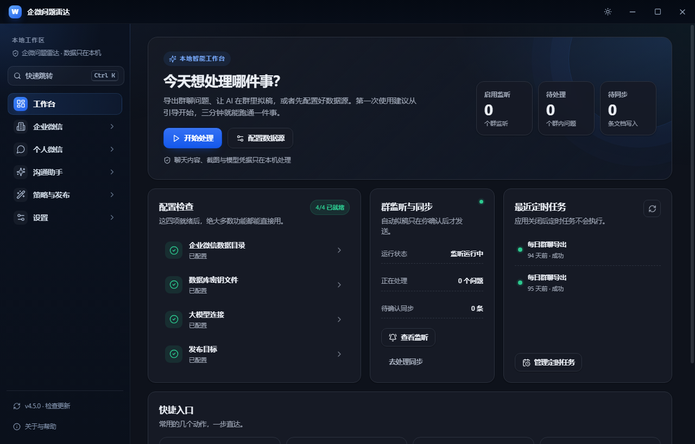

# 企微问题雷达

Windows 桌面工具：从本机企业微信群聊按时间范围提取聊天记录与截图，用 OCR / 大模型整理成结构化问题清单，导出 Excel、Markdown 或写入腾讯文档 Smart Sheet；同时提供个人微信会话草稿、群监听自动拟稿，以及回复助手、话术库、长文速读等沟通助手。聊天数据、配置和导出结果默认只留在本机。

当前版本 **v4.5.0**，桌面壳为 **Electron 45**（`v3.5.3` 是最后一个 Tauri 版本）。安装包见 [Releases](https://github.com/sy118/wecom-issue-radar/releases)，版本变更见 [CHANGELOG.md](CHANGELOG.md)。

## 核心能力地图

| 板块 | 页面 | 能做什么 |
| --- | --- | --- |
| 企业微信 | 问题雷达 / 定时任务 / 群监听回复 | 读取本机企微群聊，按起止日期与分钟级时间区间、多个群一次性导出或分析；定时任务在设定时间自动处理当天/前一天记录；群监听用 Agent V2 观察群消息并自动拟稿，默认审核后发送。 |
| 个人微信 | 会话草稿 / 配置中心 | 只读本地微信数据库，生成或改写回复草稿；复制到剪贴板，或通过本机 Rust helper 填入微信空白输入框，不点击发送。 |
| 沟通助手 | 回复助手 / 话术库 / 长文速读 | 潜台词与情绪解读、三版可编辑回复、发送前检查；分类话术与变量替换；长文摘要、要点、风险与下一步，可导出 Markdown。 |
| 策略与发布 | 提示词库 / 发布目标 / MCP 服务 / Dify 接入 | 维护问题分析、群回复、回复助手三个场景的提示词与问题字段；配置 Excel / Markdown / 腾讯文档发布目标与字段映射；登记只读 MCP 服务与已发布的 Dify Chatflow。 |
| 工作台与设置 | 工作台 / 常用与高级设置 / 关于 | 配置检查、监听与定时任务状态、待同步提示；数据目录、模型、OCR、导出位置、界面缩放、诊断与更新。 |

## 界面预览

| 工作台 | 问题雷达 |
| --- | --- |
|  |  |
| **个人微信 · 会话草稿** | **个人微信 · 配置中心** |
|  |  |
| **群监听回复** | **深色模式** |
|  |  |

截图由 `scripts/ui-preview.mjs` 在开发环境生成，使用演示数据；不包含真实聊天内容。

下面按首次使用的顺序走一遍。只做 Excel / Markdown 导出时，可以不配置模型。

## 5 分钟上手

### 1. 安装

- 系统要求：Windows 10/11 x64。
- 从 [Releases](https://github.com/sy118/wecom-issue-radar/releases) 下载最新的 `wecom-issue-radar-4.5.0-setup.exe` 安装。安装包暂未做 Authenticode 签名，SmartScreen 提示时选择「更多信息 → 仍要运行」。
- 默认按当前用户安装，业务数据写入 `%USERPROFILE%\.wecom-issue-radar`。

### 2. 连接企业微信数据

1. 保持企业微信运行并已登录。
2. 打开「设置 → 常用 → 企业微信数据」，点「自动检测」；检测不到时手动选择 Data 目录（通常在 `Documents\WXWork\<账号ID>\Data`）。
3. 点「提取数据库密钥」。首次使用需要在企业微信运行时提取一次；提取失败常见原因是企业微信未运行或需要管理员权限。

### 3. 配置模型（可选）

在「设置 → 常用 → 大模型」填写 Base URL、API Key 和模型名称，保存。只导出原始聊天不需要模型；需要识别聊天截图时，在「设置 → 高级 → 模型与 OCR」单独配置截图 OCR 模型。

全局模型配置是唯一事实来源：个人微信配置中心只读展示当前生效的模型；「Agent v2 模型能力」卡片也以当前保存的模型为准，改模型后旧检测结果会标注「上次检测（已过期）」。

### 4. 导出问题清单

1. 打开「企业微信 → 问题雷达」，选择起止日期与时间（支持跨天区间），多选群聊。
2. 在「选择处理方式」里按需开启截图 OCR、大模型分析、导出 Excel、导出 Markdown、Smart Sheet。
3. 点击开始，任务在后台顺序执行，结果按群和日期写入导出目录。
4. 在「策略与发布 → 提示词库」维护问题字段与分析规则；「发布目标」维护腾讯文档字段映射。Smart Sheet 默认先预览、确认后再写入。

如需每天自动执行，到「企业微信 → 定时任务」新建任务：执行时间、每周执行日、当天/前一天/固定日期、多个群和处理方式；单群无记录或失败不阻断后续群。

### 5. 个人微信（可选）

1. 保持微信运行并登录，打开「个人微信 → 配置中心」检测数据目录。
2. 扫描数据库密钥（从运行中的微信进程内存提取，只保存在本机），或手动填写 16 位 AES Key。
3. 创建会话项目，选择会话、摘要与回复风格；项目里的模型连接随全局设置，无需单独维护。
4. 回到「会话草稿」生成或改写草稿，复制，或填入微信空白输入框。应用**不点击发送、不模拟回车**。

### 6. 群监听（可选进阶）

1. 在「策略与发布 → MCP 服务」登记 MCP 服务并测试连接（只读工具自动可用），或在「Dify 接入」登记已发布的 Chatflow。
2. 在「企业微信 → 群监听回复」创建 Agent V2 监听器，选择群、引擎（MCP 或 Dify）和发送方式。
3. 默认「审核后发送」；切换「自动发送」前必须先完成 webhook 群内可见测试，并满足证据复核等安全门。

## 数据与安全边界

默认数据目录（可用 `WECOM_ISSUE_RADAR_HOME` 覆盖，仅建议测试或便携场景使用）：

```text
%USERPROFILE%\.wecom-issue-radar\
├─ config.local.json        # 业务配置：模型 / OCR / 提示词 / 发布目标 / 个人微信
├─ reply-runtime.sqlite3    # 群监听运行时数据库
├─ wechat.sqlite3           # 个人微信项目、消息与草稿
├─ phrases.json             # 沟通助手话术库
├─ schedule-state.json      # 定时任务状态与执行记录
├─ secrets\                 # 本机 DPAPI 加密凭据（个人微信密钥等）
├─ exports\                 # 个人微信项目导出（未指定目录时）
└─ logs\                    # 运行与 Agent 诊断日志（详细日志默认关闭）
```

- **只读原始数据**：企业微信与个人微信的原始数据库只读，个人微信临时快照用后即删；图片解析只在本机进行。
- **不自动发送**：个人微信只复制或填入空白输入框；群监听默认只生成待审核回复，自动发送必须显式开启并通过 webhook 群内可见测试；腾讯文档默认预览确认后写入，定时任务可显式开启自动同步。
- **外部写入受限**：MCP 只把 `read_only` 工具提供给模型，写/破坏性/未声明工具不暴露、不可调用。
- **密钥不出本机**：模型与 OCR API Key、Webhook、MCP Headers/Env、腾讯文档凭据不写入配置备份；个人微信凭据用 Windows DPAPI 加密保存在本机。
- **日志脱敏**：诊断日志会遮蔽 API Key、Bearer Token、Authorization、Webhook 和 MCP 密钥；但问题文本、查询参数、工具结果仍可能含业务敏感信息，详细日志默认关闭，只在排查时临时开启。
- **网络边界**：只有主动执行分析、OCR、群监听、腾讯文档同步或已登记的外部服务调用时，才会请求对应服务；应用不内置遥测。

## 架构

```text
React 18 / TypeScript / Vite 渲染层
        │ preload contextBridge（白名单 IPC）
        ▼
Electron 45 主进程
  ├─ 窗口、单实例、安全基线、更新（electron-updater → GitHub Release）
  ├─ 定时任务调度与执行历史
  ├─ Python sidecar 进程管理
  │    ├─ --request          一次性任务
  │    ├─ --reply-runtime    群监听常驻运行时
  │    ├─ --wechat-runtime   个人微信常驻 worker
  │    └─ --extract-keys     提取企业微信数据库密钥
  └─ Rust wechat-input-helper（只填入微信输入框，不发送）
        ▼
Python sidecar（PyInstaller onefile）
  ├─ 企业微信数据库解密、图片解析、Excel / Markdown 导出
  ├─ OCR / 大模型分析 / 腾讯文档预览与写入
  ├─ 个人微信只读读取、草稿与导出
  ├─ 群监听 Agent V2 / Dify
  └─ 沟通助手：回复 / 话术 / 长文速读
```

- 渲染层产物 `frontend-dist/` 由 Vite 构建，Electron main/preload 由 esbuild 打包到 `dist-electron/`；打包后的 sidecar 与 Rust helper 放在安装目录的 `resources/bin/`。
- 群监听执行模型、工具安全与恢复语义见 [docs/agent-runtime-v2.md](docs/agent-runtime-v2.md)；从 Tauri 迁移的目录与回滚说明见 [docs/electron-migration.md](docs/electron-migration.md)。

## 本地开发与验证

前置：Windows 10/11、Node.js 22+、pnpm 10.13.1、Python 3.11+（CI 使用 3.12）；仅构建微信填入 helper 时需要 Rust 1.97.1 与 `x86_64-pc-windows-msvc` target。

```powershell
pnpm install --frozen-lockfile

# 仅启动渲染层（浏览器调试，不含 Electron 外壳、sidecar 和 bridge）
pnpm dev

# 构建 Electron main/preload 并用 Electron 启动（开发模式需要 .venv 里的 Python）
python -m venv .venv
.\.venv\Scripts\python.exe -m pip install -r requirements.txt
pnpm dev:electron
```

日常验证：

```powershell
pnpm typecheck      # 渲染层 + Electron 源码类型检查
pnpm test           # 前端 vitest
pnpm build:renderer # 渲染层构建
pnpm build:electron # main/preload 构建
.\.venv\Scripts\python.exe -m unittest discover -s tests -v
```

改动群监听或 UI 时，可用 `node scripts/ui-preview.mjs --out screenshots/preview --audit` 生成浅色截图与可访问性报告，追加 `--dark` 生成深色版本（需先运行 `pnpm dev`）。

**不要在本机打包**：`pnpm package`、PyInstaller sidecar、NSIS 安装包、签名和安装级冒烟验证一律交给 GitHub Actions 的 Windows Runner 完成。需要构建 Rust helper 时：

```powershell
rustup target add x86_64-pc-windows-msvc
cargo build --release --manifest-path native\wechat-input-helper\Cargo.toml --target x86_64-pc-windows-msvc
```

## 发布

版本唯一来源是 `package.json`（当前 `4.5.0`），不在本机打包。

- **PR / push 到 `main`**：`ci.yml` 跑快速门禁——前端 `pnpm test` / `pnpm typecheck`、renderer 与 Electron bundle 构建、Rust helper（fmt / clippy / test / build）、Python 单测与 PyInstaller sidecar 自检，不产出安装包。
- **push 到 `main`**：`build-windows.yml` 完整构建并上传安装包 Artifact `wecom-issue-radar-windows-x64`（exe、`latest.yml`、blockmap，保留 14 天），不发布 Release。
- **push tag `v4.5.0`**：先校验 tag 格式、tag 与 `package.json` 版本一致、commit 包含在 `main`，再构建 NSIS 安装包与兼容旧 Tauri 客户端的 `latest.json`，创建 draft Release、上传资产后自动发布，并从公网回拉校验更新清单。

发布细节、失败处理与回滚见 [docs/release.md](docs/release.md)。

## 常见问题与排障

- **检测不到企业微信数据目录**：确认企业微信已安装并运行；目录通常在 `Documents\WXWork\<账号ID>\Data`。多账号、OneDrive 或非默认盘符时会返回多个候选，按数据库最近修改时间排序，可在「设置 → 高级 → 企业微信与目录」手动指定。
- **提取密钥失败**：企业微信必须处于运行且已登录状态；部分机器需要以管理员身份运行应用。也可以手动选择已有的密钥文件。
- **改了模型，界面还显示旧模型**：v4.5.0 起全局 `config.llm` 是唯一来源。先确认「设置 → 常用 → 大模型」已保存；「Agent v2 模型能力」卡片若显示「上次检测（已过期）」，说明检测结果对应旧配置，点「检测全部能力」重新检测；个人微信配置中心只读展示全局模型，无需也不支持在那里改模型。
- **大模型分析报错或超时**：先在「设置 → 高级 → 模型与 OCR → Agent v2 模型能力」检测结构化输出与工具调用是否通过；再检查 Base URL、API Key、模型名和网络。群监听可适当降低轮次与工具调用预算。
- **截图 OCR 不生效**：截图 OCR 是独立模型，需要在「模型与 OCR」里单独配置；企业微信未运行或图片尚未写入本机缓存时会缺图，可稍等或使用「重新读取图片」。
- **群监听没有发出去**：检查「群监听回复 → 待发送」，审核模式下通过证据检查的回复会在这里等待发送或放弃；自动发送需要先完成 webhook 群内可见测试，未通过安全门时任务会转入待发送，不会静默失败。
- **腾讯文档同步失败**：检查 Corp ID / Corp Secret、目标模板与字段映射、必填项与枚举、模板 revision；先预览再确认写入。写入不是严格 exactly-once，中断后应先核对远端文档再重试。
- **个人微信检测不到或密钥扫描失败**：确认微信运行并登录；部分微信版本需要管理员权限。已配置目录时默认复用，只有手动「重新扫描」才会重新全量检测。
- **安装或更新提示**：安装包暂未签名，SmartScreen 提示按第 1 步处理；应用内更新从 GitHub Release 读取 `latest.yml`，只升不降，回滚需发布更高版本或手动重装旧安装包。
- **换电脑或备份**：「设置 → 高级 → 企业微信与目录 → 备份配置」不包含 API Key、Webhook、MCP 密钥、腾讯凭据和本机路径，换机后需要重新填写并重新提取企业微信密钥。
- **卸载会删数据吗**：不会。卸载只移除程序，业务数据仍在 `%USERPROFILE%\.wecom-issue-radar`，需要时手动删除。

### 常用快捷键

| 快捷键 | 作用 |
| --- | --- |
| `Ctrl/Cmd + K` | 快速跳转到任意页面或功能 |
| `Ctrl/Cmd + S` | 在提示词库保存当前提示词 |
| `Ctrl/Cmd + Enter` | 在回复助手 / 长文速读生成结果 |
| `Esc` | 关闭最上层弹窗或抽屉 |
| `Tab` / `Shift + Tab` | 弹层内循环焦点，关闭后焦点回到触发位置 |

## 文档索引

- [docs/README.md](docs/README.md)：文档总索引与阅读路径。
- [CHANGELOG.md](CHANGELOG.md)：版本变更记录，v4.5.0 见最新条目。
- [docs/agent-runtime-v2.md](docs/agent-runtime-v2.md)：群监听执行模型、工具安全、检查点恢复与诊断。
- [docs/electron-migration.md](docs/electron-migration.md)：Tauri → Electron 的架构、命令、数据位置与回滚。
- [docs/release.md](docs/release.md)：GitHub Actions 构建发布、版本规则、失败处理与回滚。
- [docs/dify-chatflow-api.md](docs/dify-chatflow-api.md)：Dify Chatflow API 的文件上传与对话接入契约。
- [docs/tencent-smartsheet-image-fields.md](docs/tencent-smartsheet-image-fields.md)：企业微信智能表格 Webhook 图片字段说明。
- [docs/jev-annotation-set.md](docs/jev-annotation-set.md)：Jev 语义阈值校准所需的脱敏标注集与上线门禁。

## 致谢

本桌面程序参考陈俊宏同学的《AI群咨询日期级自动拉取、识别、登记 WeCom Daily Issue Pipeline v2》思路，感谢原作者的开源。
